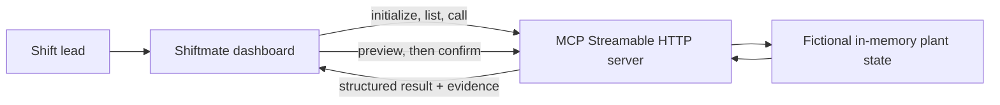

# Shiftmate architecture and implementation notes

## 1. Product goal

Shiftmate gives a shift lead one place to ask practical questions about a small manufacturing cell. The current build demonstrates how a conversational front end can discover typed tools, retrieve records from a bounded domain, cite the evidence it received, and stop for a human decision before any write-like action. It is an interactive prototype for reviewing an assistant workflow. It is not an industrial control system, production decision system, or connection to a real factory.

The intended demo story is deliberately narrow: a lead sees an alert, asks what the evidence says, traces the affected batch, creates a draft maintenance item, and hands the key facts to the next shift. This makes the relationship between question, retrieved record, recommendation, and operator confirmation visible.

## 2. System at a glance

### Browser client — `index.html`

The browser page contains the responsive operations console, sample metrics, natural-language intent routing, speech input where supported, and the MCP client. It calls the MCP endpoint for every mapped question once connected. The intent router is deterministic: it chooses a tool and arguments from a handful of phrases. It does not call a language model, infer hidden facts, or fabricate a tool result. The page renders returned content and a source line that identifies the evidence fields or records.

The dashboard also includes line filters, a configurable vibration threshold, adjustable auto-refresh, a manual refresh control, a draft work-order form, a voice conversation toggle, and browser-local preferences. Those controls affect the interface or simulated demo state only. The client cannot command a machine.

### Tool server — `server.mjs`

The server uses Node.js built-in HTTP and crypto modules. It binds to `127.0.0.1` by default and exposes a single `/mcp` route. The server owns a fictional sample dataset, in-memory session records, short-lived action previews, a local demo ticket list, and a small audit array for simulated line state changes.

The server implements JSON-RPC 2.0 request dispatch for MCP initialization, `ping`, `tools/list`, and `tools/call`. It negotiates the requested protocol version `2025-11-25`, returns a session identifier on initialization, checks `MCP-Protocol-Version` and `MCP-Session-Id` on later requests, and accepts browser origins only from loopback hosts. It responds with JSON rather than opening a server-sent event stream; clients must make requests to receive data. The page hosts static assets separately from the server, which is why the README runs two local processes.

### Data model

`createPlantState()` constructs isolated state for each test or server instance. It includes three fictional production lines, one aggregate quality record, three batch trace records, two sample alerts, simulated tickets, paused line IDs, one-use action previews, and a small audit list. Every count, sensor reading, timestamp, material lot, inspection, batch, and line is illustrative. None is sourced from a plant historian, MES, QMS, CMMS, PLC, or physical sensor.

State is in memory and resets when the server restarts. This makes a demo repeatable and avoids requiring a database. It also means this build offers no persistence, access control, multi-user coordination, retention policy, or transaction guarantee across processes.

## 3. MCP tools

The server advertises eight tools using JSON Schemas. Read tools are marked read-only; preview/confirmation tools are not. The descriptions state that the dataset is fictional and bounded.

| Tool | Input | Output purpose | State effect |
|---|---|---|---|
| `get_shift_summary` | None | Current simulated output, yield, line states, and highest-priority signal | None |
| `get_line_diagnostics` | `lineId` in 1–3 | Sensor readings, shift-start comparison, threshold severity, and a bounded next step | None |
| `get_quality_summary` | None | First-pass yield, target, reject categories, and next scheduled sample | None |
| `get_batch_trace` | One known `batchId` | Production counts, material lot, process revision, inspection, reject split, evidence | None |
| `get_shift_handoff` | None | Incoming-shift brief, priority signal, quality state, checklist, and open draft work | None |
| `list_open_actions` | None | Sample alerts, draft tickets, and pending preview count | None |
| `prepare_demo_action` | Action, line, optional issue | Preview object with expiry and explicit simulated effect | Adds pending preview only |
| `confirm_demo_action` | Preview ID, `confirmed: true` | Applies the approved local demo change and returns a notice | Draft ticket or simulated pause/resume |

### Evidence and interpretation

Tool outputs separate source readings from interpretation. For example, line diagnostics provide the numeric vibration value, threshold, change since shift start, and a `rule-based threshold check` label. The recommendation is a canned response tied to the threshold band. It is not a machine-learning prediction or a validated maintenance policy. Batch trace includes its explicit record label and a warning against using it for release or recall decisions.

The browser places source names, sample windows, and method labels alongside the response. If a question does not map to a known tool, the UI explains the supported prompts and makes no server call. This keeps the demo explainable; it also limits the range of questions the assistant can answer.

## 4. Write-like action lifecycle

The demo separates preparation from application:

1. The user asks to create a work order or pause/resume a line.
2. The browser calls `prepare_demo_action` with a validated action and line ID.
3. The server checks that the target exists and that the requested line transition makes sense in its simulated state.
4. The server creates a random preview ID that expires after five minutes. Preparation does not add a ticket or change a line state.
5. The UI displays a confirmation card that says the change is local and simulated. The operator can confirm or cancel.
6. Confirmation consumes the preview once. Expired, unknown, declined, or replayed previews do not apply an action.
7. The server returns a status and explicitly states that no external system was contacted.

This is a product demonstration of a human checkpoint, not a production authorization design. A deployed system would need an authenticated identity, role checks, action-specific policy, durable audit records, concurrency control, a safe integration boundary, and independent operational approval.

## 5. Request sequence

The browser and server use these steps when a page loads:

1. Browser sends `initialize` with protocol version, capabilities, and client identity.
2. Server creates a session and returns server identity, tool capability, and `MCP-Session-Id`.
3. Browser sends `notifications/initialized`.
4. Browser calls `tools/list` and stores the returned tool catalog for this page session.
5. On a question, deterministic routing selects a tool. The page calls `tools/call` with the MCP session and protocol headers.
6. Server returns JSON-RPC result content and structured content; the page renders a concise answer and source line.
7. A previewed action requires a separate `tools/call` after a user click or supported voice confirmation.

There is no server-initiated event stream, cloud model, account login, or remote factory connection in this sequence.

## 6. Failure handling

- **Server is offline:** the client explains how to start it and does not claim that an MCP call succeeded.
- **MCP session has expired:** the server returns a session error. Reloading the page creates a fresh session.
- **Unknown tool or invalid line/batch:** the server returns a tool error without changing state.
- **Action preview is missing, expired, or reused:** confirmation fails and the operator must prepare a new preview.
- **Browser lacks speech recognition:** text input remains available; voice is an optional capability.
- **Unsupported language or intent:** the assistant shows example prompts and does not perform a guessed action.
- **Static page served from a non-loopback origin:** browser CORS checks intentionally block the request. Use `localhost` as documented.

## 7. Repository map

| Path | Responsibility |
|---|---|
| `index.html` | Dashboard, accessible interaction controls, deterministic routing, browser MCP client |
| `server.mjs` | MCP JSON-RPC dispatch, local HTTP transport, fictional plant state, demo tools |
| `test/server.test.mjs` | Protocol, tool, evidence, handoff, and action confirmation tests |
| `mcp-config.json` | Local MCP endpoint and transport metadata |
| `DEMO_RUNBOOK.md` | Reviewer setup and repeatable demo sequence |
| `SAFETY_AND_LIMITATIONS.md` | Trust boundaries and production gaps |
| `HACKATHON_SUBMISSION.md` | Submission copy, implementation account, product feedback, friction log |

## 8. Design decisions

### Why a local sample dataset?

It makes the project runnable without a manufacturing account, customer data, or paid service. A reviewer can inspect a complete interaction quickly. The tradeoff is that the project demonstrates interaction design and protocol integration, not a real operational outcome.

### Why deterministic intent routing?

It keeps the user-visible path stable and lets a reviewer know which tool a phrase will call. It avoids implying a general-purpose AI assistant where none is connected. The tradeoff is reduced language flexibility. A future agent could improve phrasing while retaining tool-level data boundaries and explicit evidence.

### Why human confirmation?

Drafting and simulated line transitions are the most consequential interactions in the demo. Previewing them separately makes the proposed target, issue, and effect reviewable before the local state changes. The confirmation token is short-lived and single-use to make replay tests meaningful.

### Why no AWS service in this version?

The selected implementation path is the hackathon's Alexa+ self-hosted MCP-server track. This version does not claim AWS Builder mini-challenge eligibility. Adding an AWS service solely as a label would not improve the working user flow. A future, separately documented AWS-backed feature could store approved, anonymized shift reports or provide a managed model gateway after credential, privacy, and cost controls are designed.

## 9. Extension points

Potential next steps, in order of increasing operational impact:

1. Add typed filters, pagination, and richer chart data to the read-only tools.
2. Add a configurable sample dataset and seed/reset control for repeatable demos.
3. Persist only demo state in a local file, with versioned schema and explicit reset behavior.
4. Add a real authenticated identity layer before storing operator-specific actions.
5. Connect a simulator or approved read-only data source behind a separate adapter, retaining the fictional mode as the safe default.
6. Add an evaluated language model only for intent interpretation or summarization, with server-side schema validation and evidence constrained to tool results.
7. Conduct a safety, privacy, security, and reliability review before any real equipment or work-order integration.

No step above is implemented by this repository today.
